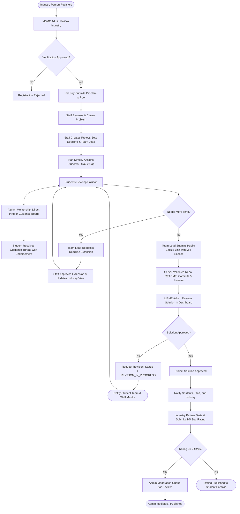
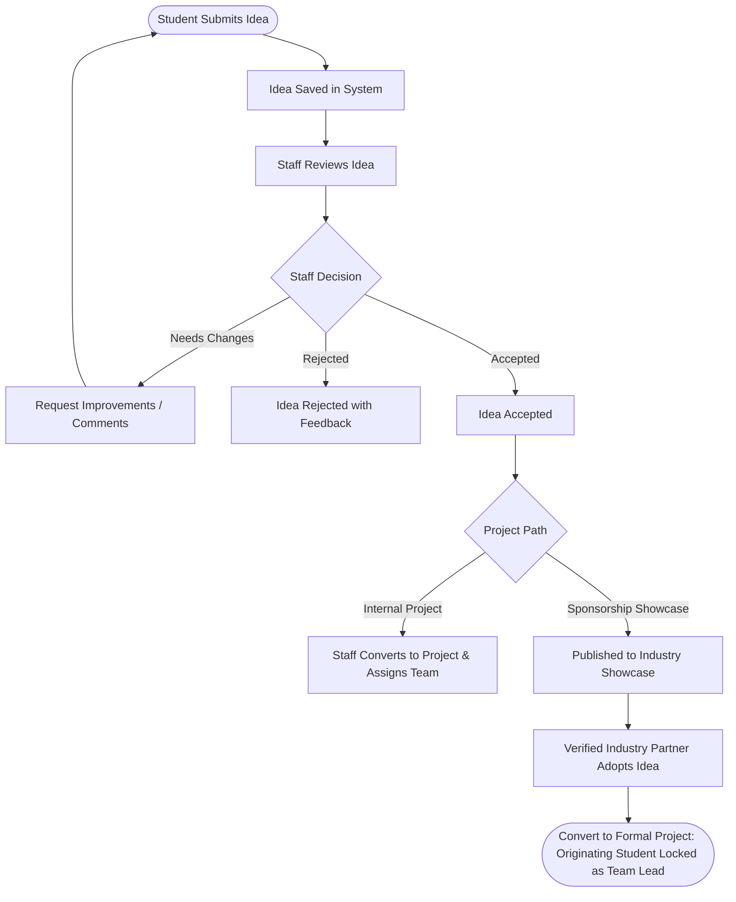

# Product Requirements Document (PRD)
## MSME-Hub: Industry-Academia Collaborative Innovation Platform

---

| **Document Metadata** | **Details** |
| :--- | :--- |
| **Product Name** | MSME-Hub |
| **Document Version** | 1.4.0 |
| **Status** | Technical Stack Ratified (Better Auth + Neon + Prisma + Tailwind/shadcn + Vercel) |
| **Primary Target Release** | MVP (Phase 1–4) |
| **Framework Used** | Lenny's 1-Pager / Bounded PRD Architecture |

---

## 1. Executive Summary & Project Description

**MSME-Hub** is a unified, role-governed digital bridge connecting Micro, Small, and Medium Enterprises (MSMEs), academic institutions (students and staff/faculty), and alumni mentors. 

The platform facilitates two core innovation pipelines:
1. **Industry-to-Academia Problem Resolution**: Verified industry partners submit real-world industrial challenges. Academic staff triage and claim these from a domain pool, converting them into collaborative projects staffed with 1–N students (directly assigned, max 2 active projects per student) led by a designated Student Team Lead. Teams build public GitHub solutions (licensed under MIT) with direct mentorship and Open Guidance Board requests to alumni, inspected via server-cached in-dashboard GitHub trees, validated by MSME Admins, and closed with moderated Industry Partner satisfaction ratings.
2. **Student Innovation Incubation**: Students submit independent ideas for faculty review, iteration, and potential promotion into formal projects or an industry-facing Sponsorship Showcase where adopting companies sponsor the idea with the student guaranteed as Team Lead.

---

## 2. Problem Statement

### The Core Problem
MSMEs encounter pressing technical bottlenecks and digital transformation gaps but lack the capital to commission large consulting agencies or hire dedicated R&D units. Simultaneously, engineering students routinely work on artificial or outdated capstone projects with zero market validation, while alumni mentors have no structured channel to guide their alma mater's talent.

### Why This Matters Now
Without a centralized, verified platform:
- **Industry Partners** face unvetted student outreach, lack accountability for project deliverables, suffer IP ambiguities, and cannot grade delivered work.
- **Academic Staff** lack a single workbench to discover authentic industry problems, claim challenges by domain, assemble multi-student teams, handle mid-flight roster changes, and monitor deadlines.
- **Students** graduate without production-grade, industry-vetted project portfolios on GitHub and are limited by siloed academic grading.
- **Alumni Mentors** remain an untapped feedback resource due to the absence of targeted discovery and direct student outreach channels.
- **MSME Admins / Governing Bodies** cannot track regional industrial-academic synergy, deliverable quality, or verification integrity.

---

## 3. Goals & Measurable Success Metrics

### Primary Goals
1. Establish a verified, trusted conduit for MSMEs to submit operational problems to university teams.
2. Provide staff with direct multi-student project assignment, claimable domain pools, deadline extension governance, and student concurrency enforcement (max 2 active projects/student).
3. Deliver a transparent solution pipeline where student public GitHub submissions (MIT licensed) are inspected in-dashboard, guided by alumni via direct pings or the Guidance Board, approved by MSME administrators, and rated by industry partners with moderation protection.
4. Support an independent idea incubator for student-initiated innovation with an Industry Sponsorship Showcase that preserves student leadership.

### Success Criteria (KPIs)

| Metric | Target (Post-Launch 6 Months) | Measurement Method |
| :--- | :--- | :--- |
| **Industry Verification Turnaround** | < 48 hours from registration | Time delta: Registration to Admin Approval |
| **Problem-to-Project Conversion Rate** | > 70% of accepted problems claimed | Ratio of Assigned Projects to Approved Problems |
| **Solution Approval Rate** | > 85% approved (first pass or after revision) | Final Admin Approvals / Total Submitted GitHub Solutions |
| **Student Collaborative Coverage** | Average 2–4 students assigned per project (capped at 2 active projects/student) | Platform assignment metrics |
| **Alumni Feedback Engagement** | > 60% of active projects receive feedback/guidance | Alumni comment and Guidance Request counts |
| **Industry Satisfaction Score** | Average ≥ 4.2 / 5.0 stars | Post-approval industry ratings |

---

## 4. Non-Goals (Explicitly Out of Scope for v1)

To maintain focus and avoid scope creep:
- ❌ **In-Platform Code Execution / Cloud IDE**: MSME-Hub will not compile code or host containerized runtimes. All code deliverables are submitted as valid public GitHub repository URLs and inspected via server-cached GitHub REST API calls.
- ❌ **Financial / Escrow Transactions**: Direct stipend disbursement, commercial licensing payments, and financial contracting will be handled offline in v1.
- ❌ **Real-Time Video Conferencing**: The platform will not embed video calls; external links (e.g., Google Meet, Zoom) can be shared in project briefs if needed.
- ❌ **Direct Industry-to-Student Bypassing**: Industry partners cannot directly contact or assign students without Staff mediation and MSME Admin governance.
- ❌ **Public Admin Self-Registration**: MSME Admin accounts cannot register via web forms; initial root admin is seeded via secure CLI scripts.

---

## 5. User Roles & Personas

The system enforces strict Role-Based Access Control (RBAC) across five user personas:

| # | Role | Description & Primary Function |
| :--- | :--- | :--- |
| **1** | **MSME Admin** *(Super Admin)* | Provisioned via CLI seed. The central governance body. Verifies and approves Industry Partner registrations, reviews final GitHub solution submissions, moderates 1–2 star industry ratings, and exercises system-wide oversight. |
| **2** | **Industry Person** *(MSME Partner)* | Registers corporate/business credentials (subject to Admin verification), submits industrial problems/challenges, adopts showcase ideas, and rates final approved solutions. |
| **3** | **Staff / Faculty** *(Project Director)* | Authenticates via Google Workspace OAuth. Claims submitted industry problems from a domain pool, creates formal projects, directly assigns multi-student teams (designating a Team Lead, respecting max 2 cap), manages mid-flight roster changes & deadline extensions, and evaluates independent student ideas. |
| **4** | **Student** *(Builder / Solver)* | Authenticates via Google Workspace OAuth. Submits independent ideas, works on directly assigned projects (max 2 active), submits guidance requests (direct or board), resolves guidance threads with endorsements, requests deadline extensions, and submits MIT-licensed public GitHub solution URLs via Team Lead. |
| **5** | **Alumni** *(Expert Mentor)* | Verified via 1-click admin/staff queue. Discovers active projects by domain/tech stack, answers Guidance Board requests and direct pings, earns Helpful endorsements, and leaves actionable architectural critique. |

---

## 6. Role-Based Access Control (RBAC) Matrix

| Feature / Action | Student | Staff | Alumni | Industry | MSME Admin |
| :--- | :---: | :---: | :---: | :---: | :---: |
| Authenticate via Google Workspace OAuth | ✅ | ✅ | ❌ | ❌ | ❌ |
| Register Account with Document Verification | ❌ | ❌ | ✅ *(1-Click Queue)* | ✅ *(Pending Admin)* | Pre-seeded / Root |
| Verify Industry / Alumni Registration | ❌ | ✅ *(Alumni only)* | ❌ | ❌ | ✅ *(Both)* |
| Submit Industry Problem | ❌ | ❌ | ❌ | ✅ *(If Verified)* | ✅ *(Override)* |
| Claim Problem from Domain Pool | ❌ | ✅ | ❌ | ❌ | ✅ |
| Directly Assign Multi-Student Team (Max 2 cap) | ❌ | ✅ | ❌ | ❌ | ✅ |
| Designate Student Team Lead | ❌ | ✅ | ❌ | ❌ | ✅ |
| Modify Mid-Flight Team Roster | ❌ | ✅ | ❌ | ❌ | ✅ |
| Request Deadline Extension | ✅ *(Team Lead Only)* | ❌ | ❌ | ❌ | ❌ |
| Approve / Decline Deadline Extension | ❌ | ✅ | ❌ | ❌ | ✅ |
| View Assigned Projects & In-Dashboard GitHub Tree | ✅ *(Own)* | ✅ *(Department)* | ✅ *(All Public)* | ✅ *(Own)* | ✅ *(All)* |
| Submit / Update GitHub Solution Link (MIT License) | ✅ *(Team Lead Only)* | ❌ | ❌ | ❌ | ❌ |
| Post to Guidance Board / Direct Ping Alumni | ✅ | ❌ | ❌ | ❌ | ❌ |
| Resolve Guidance Request & Award Endorsement | ✅ | ❌ | ❌ | ❌ | ❌ |
| Provide Alumni Mentorship Feedback | ❌ | ❌ | ✅ | ❌ | ✅ |
| Review Solution & Request Revisions | ❌ | 👁️ *(Notified)* | 👁️ *(View)* | 👁️ *(View)* | ✅ |
| Approve / Reject Solution | ❌ | ❌ | ❌ | ❌ | ✅ |
| Provide Industry Rating (1–5 Stars) | ❌ | ❌ | ❌ | ✅ *(Post-Approval)* | 👁️ *(View)* |
| Moderate Low Ratings (≤ 2 Stars) | ❌ | ❌ | ❌ | ❌ | ✅ |
| Submit Independent Idea | ✅ | ❌ | ❌ | ❌ | ❌ |
| Review Student Ideas (Accept/Reject/Revise) | ❌ | ✅ | ❌ | ❌ | ✅ |
| Publish Idea to Sponsorship Showcase | ❌ | ✅ | ❌ | ❌ | ✅ |
| Adopt Showcase Idea (Locked Student Lead) | ❌ | ❌ | ❌ | ✅ | ❌ |

---

## 7. End-to-End Workflows & State Machines

### 7.1. Workflow 1: Industry Problem-to-Solution Lifecycle



---

### 7.2. Workflow 2: Student Idea Incubation & Showcase Adoption Lifecycle



---

## 8. Functional Requirements by Module

### 8.1. Authentication & User Governance
- **REQ-AUTH-01**: Institutional Google Workspace OAuth mandatory for Students and Staff. Enforces domain whitelist filter (e.g. `@institution.edu`) configurable in environment/admin settings.
- **REQ-AUTH-02**: Industry Registration captures Company Name, Registration/Udyam Number, Official Website, Representative Details, and Business Proof PDF. Requires MSME Admin manual approval before problem submission is unlocked.
- **REQ-AUTH-03**: Alumni Registration captures Degree, Graduation Year, Current Company/Role, and LinkedIn profile. Placed in a 1-click verification queue accessible by Staff and Admins.
- **REQ-AUTH-04**: Root MSME Admin is provisioned via CLI seed script (`npm run seed:admin`), with no public registration interface.

### 8.2. MSME Admin Module
- **REQ-ADM-01 - Verification Queue**: Dashboard listing pending Industry profiles (with PDF certificate preview) and Alumni registrations. Actions: `Approve` or `Reject` (with justification).
- **REQ-ADM-02 - Solution Approval Gate**: Inspection desk for projects in `SOLUTION_SUBMITTED` state, displaying:
  - Original Industry Problem Statement and expected deliverables.
  - In-Dashboard GitHub File Tree, README, and MIT License viewer (fetched and cached via server-side GitHub App).
  - Alumni feedback log and Student guidance threads.
  - Decision buttons: `Approve Solution` or `Request Revision` (mandatory structured notes).
- **REQ-ADM-03 - Rating Moderation Desk**: Review queue for all industry ratings of 1 or 2 stars with actions to approve public display, mediate revisions with industry partner, or record resolution.
- **REQ-ADM-04 - System Analytics**: Counters for verified MSMEs, active problems in pool, active projects, completed solutions, and average industry satisfaction ratings.

### 8.3. Industry Partner Module
- **REQ-IND-01 - Problem Creator**: Form with Problem Title, Industry Domain tag, Detailed Description, Constraints, Expected Deliverables, and Target Timeline.
- **REQ-IND-02 - Problem & Deliverable Tracker**: View lifecycle status of submitted problems (`In Pool` -> `Claimed` -> `In Progress` -> `Solution Submitted` -> `Approved`).
- **REQ-IND-03 - In-Dashboard Solution Inspector**: Access to the approved public GitHub repository, folder tree, and project summary.
- **REQ-IND-04 - Industry Rating & Testimonial**: Post-approval modal to submit 1–5 star rating across: Timeliness, Technical Quality, and Communication, plus a written recommendation testimonial.
- **REQ-IND-05 - Sponsorship Showcase Browser**: View staff-accepted student innovation ideas and click `Adopt & Sponsor`, automatically converting into a project with the student as lead.

### 8.4. Staff / Faculty Module
- **REQ-STF-01 - Domain Problem Pool**: Browse and filter verified industry problems by domain/tech category. One-click `Claim Problem` action.
- **REQ-STF-02 - Project Builder & Direct Team Assignment**:
  - Convert claimed problem into an active Project with a target deadline.
  - Direct assignment of 1 to N students from directory (active projects strictly capped at 2 per student).
  - Designate exactly 1 Student as the `Project Team Lead`.
- **REQ-STF-03 - Mid-Flight Roster & Deadline Management**:
  - Exclusive authority to add, remove, or swap student team members.
  - Review queue for Deadline Extension Requests submitted by Team Leads.
- **REQ-STF-04 - Revision Triage**: When Admin marks a project as `REVISION_IN_PROGRESS`, staff dashboard displays alert banner with itemized admin notes.
- **REQ-STF-05 - Student Idea Evaluator**:
  - Review queue for independent student ideas.
  - Decision options: `Accept`, `Reject`, or `Request Improvements`.
  - Actions for accepted ideas: `Convert to Internal Project` or `Publish to Sponsorship Showcase`.

### 8.5. Student Module
- **REQ-STU-01 - Student Workspace**: Personalized dashboard showing active projects (strictly capped at 2), assigned team members, Team Lead status, and industry problem brief.
- **REQ-STU-02 - GitHub Solution Submission**:
  - Enabled exclusively for the designated `Project Team Lead`.
  - Input field for Public GitHub repository URL.
  - Automated check: validates URL, ensures repo is public, has commits, contains a README, and includes an `MIT License`.
  - Live in-dashboard preview of cached GitHub folder/file tree.
- **REQ-STU-03 - Hybrid Guidance Request Engine**:
  - Tag specific registered Alumni directly or post to the institutional Open Guidance Board with domain/technology tags.
  - Ability to mark guidance threads as `Resolved` and award a `Helpful Endorsement` to the mentor.
- **REQ-STU-04 - Deadline Extension Request**: Team Lead can submit a formal extension request with reason to the Staff mentor.
- **REQ-STU-05 - Idea Submission Portal**: Pitch form for independent innovation ideas, with revision resubmission capabilities when marked as `NEEDS_CHANGES`.

### 8.6. Alumni Module
- **REQ-ALM-01 - Project Discovery & Guidance Board Hub**:
  - Directory of active public projects filtered by domain and tech stack.
  - Open Guidance Board displaying open student queries tagged by technology.
  - Profile counter displaying cumulative `Helpful Endorsements` earned.
- **REQ-ALM-02 - Actionable Feedback Engine**:
  - Commenting and code architecture critique interface on project detail view.
  - In-dashboard preview of student's GitHub folder tree to give contextual code feedback.

---

## 9. Conceptual Data Schema & Entity Relationships

```
+--------------------+           +----------------------+
|       Users        | 1       * |       Feedback       |
|--------------------|-----------|----------------------|
| id (UUID)          |           | id (UUID)            |
| name               |           | projectId (FK)       |
| email              |           | authorId (FK: Alumni)|
| role (ENUM)        |           | category             |
| authProvider       |           | content              |
| isVerified (Bool)  |           | createdAt            |
+--------------------+           +----------------------+
        | 1                                 ^
        |                                   | *
        +-----------------------------------+----------------------+
        | 1                                 |                      |
+--------------------+           +----------------------+          |
|  IndustryProfile   |           |       Projects       |          |
|--------------------|           |----------------------|          |
| id (UUID)          |           | id (UUID)            |          |
| userId (FK)        |           | problemId (FK, opt)  |          |
| companyName        |           | ideaId (FK, opt)     |          |
| udyamRegNo         |           | title                |          |
| domain             |           | status (ENUM)        |          |
| verificationDocUrl |           | staffId (FK)         |          |
+--------------------+           | targetDeadline       |          |
        | 1                      | githubUrl            |          |
        |                        | adminReviewNotes     |          |
        | *                      +----------------------+          |
+--------------------+                      | 1                    |
|      Problems      | 1                    |                      |
|--------------------|----------------------+                      |
| id (UUID)          |           +----------------------+          |
| industryId (FK)    |           |    ProjectMembers    |          |
| title              |           |----------------------|          |
| description        |           | id (UUID)            |          |
| domain             |           | projectId (FK)       |          |
| status (ENUM)      |           | studentId (FK)       |          |
| claimedByStaffId   |           | isLead (Bool)        |          |
+--------------------+           +----------------------+          |
                                            |                      |
+--------------------+           +----------------------+          |
|       Ideas        | 1       * |   GuidanceRequests   |          |
|--------------------|-----------|----------------------|          |
| id (UUID)          |           | id (UUID)            |          |
| studentId (FK)     |           | projectId (FK)       |----------+
| title              |           | requestedByStudentId |
| description        |           | alumniId (FK, opt)   |
| status (ENUM)      |           | tags (String[])      |
| isShowcase (Bool)  |           | question             |
+--------------------+           | status (ENUM)        |
                                 | isHelpful (Bool)     |
+--------------------+           +----------------------+
|   IndustryRatings  |
|--------------------|           +----------------------+
| id (UUID)          |           |  DeadlineExtensions  |
| projectId (FK)     |           |----------------------|
| industryId (FK)    |           | id (UUID)            |
| stars (Int 1-5)    |           | projectId (FK)       |
| feedbackText       |           | requestedDate        |
| isModerated (Bool) |           | reason               |
| createdAt          |           | status (ENUM)        |
+--------------------+           +----------------------+
```

---

## 10. Technical Architecture & Technology Stack

1. **Framework & Client Layer**:
   - **Framework**: Next.js (App Router, React 19, TypeScript).
   - **Styling**: Tailwind CSS (v4) with CSS variables.
   - **Component Library**: shadcn/ui (Radix UI accessible primitives, Lucide icons).
   - **Forms & Validation**: React Hook Form with Zod schemas and Next.js Server Actions for type-safe end-to-end mutations.
   - **Layout Architecture**: Dynamic role-aware layouts (`/dashboard/student`, `/dashboard/staff`, `/dashboard/industry`, `/dashboard/alumni`, `/dashboard/admin`).
2. **Authentication & Session Management**:
   - **Provider**: **Better Auth** with the Prisma adapter.
   - **Institutional OAuth**: Google Workspace OAuth with domain whitelisting hooks for Students and Staff (`@college.edu`).
   - **Credential & Verification**: Email/password authentication for verified Industry Partners, Alumni, and CLI-seeded MSME Admins.
   - **Session Storage**: Database-backed sessions managed via PostgreSQL.
3. **Data Layer & ORM**:
   - **Database**: **Neon Serverless PostgreSQL** (connection pooling with pgbouncer for serverless scalability, `DATABASE_URL` for pooling, `DIRECT_URL` for migrations).
   - **ORM**: Prisma ORM (declarative schema, migrations, type-safe PrismaClient).
   - **GitHub Tree Caching**: In-database JSON column on `Project` (`githubTreeJson: Json?`, `githubTreeCachedAt: DateTime?`) with 5-minute TTL.
4. **Hosting & Deployment**:
   - **Platform**: **Vercel** (Next.js serverless functions, edge routing, automated CI/CD previews, production deployments).
   - **Build Command**: `prisma generate && next build`.
5. **External Integrations & Utilities**:
   - **GitHub REST API**: Server-side proxy with Personal Access Token validating public status, commits, README, and MIT license, with in-dashboard tree rendering.
   - **Document Storage**: **Vercel Blob** for direct PDF uploads and signed URL previews of industry business proof (Udyam certificates).
   - **Notifications**: **Resend with React Email** for branded transactional emails on state transitions.

---

## 11. Edge Cases & Risk Mitigation

| Risk / Edge Case | Impact | Mitigation Strategy |
| :--- | :--- | :--- |
| **GitHub API Rate Limiting** | Dashboards fail during classroom project reviews. | Server-side GitHub token + 5-minute in-memory/DB caching layer. |
| **Student Project Hoarding** | High-performing students take too many projects and stall out. | System strictly caps active project assignments to **2 per student**; staff direct assignment picker enforces this. |
| **Dead / Broken / Unlicensed GitHub Links** | Incomplete or non-compliant deliverables submitted. | Automated API test verifies repo exists, is public, has commits, contains a README, and includes an `MIT License`. |
| **Alumni Abandonment of Guidance Requests** | Students wait indefinitely for alumni help. | Hybrid model: students can post to the Open Guidance Board with tags; auto-archive after 7 days of inactivity. |
| **Industry Rating Hostility** | Unfair negative rating after student effort. | Ratings ≤ 2 stars are routed to the Admin Moderation Queue before appearing on student portfolios. |
| **Student Inactivity Mid-Project** | Project stalls due to dropped students. | Staff holds exclusive rights to add, remove, or swap student team members at any time. |
